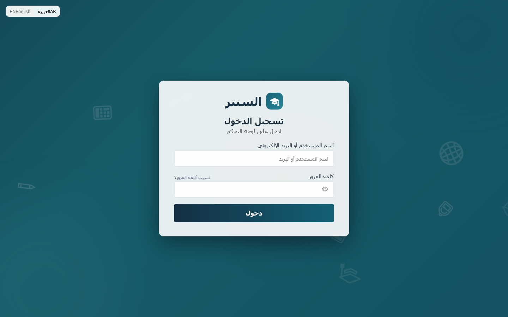
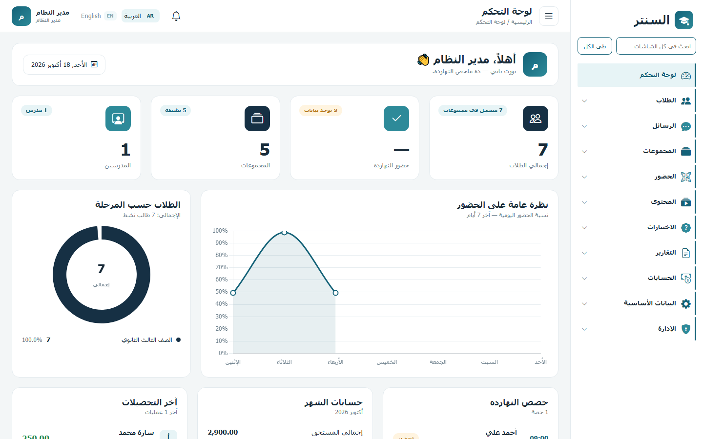
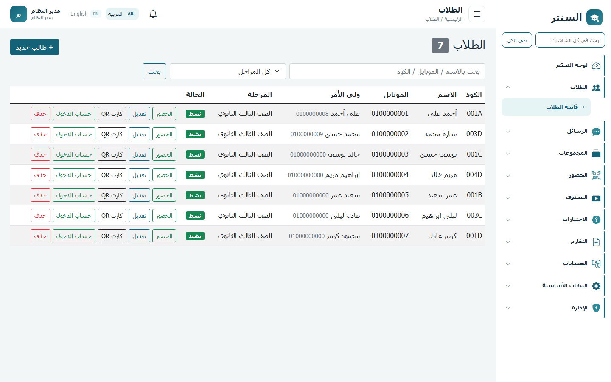
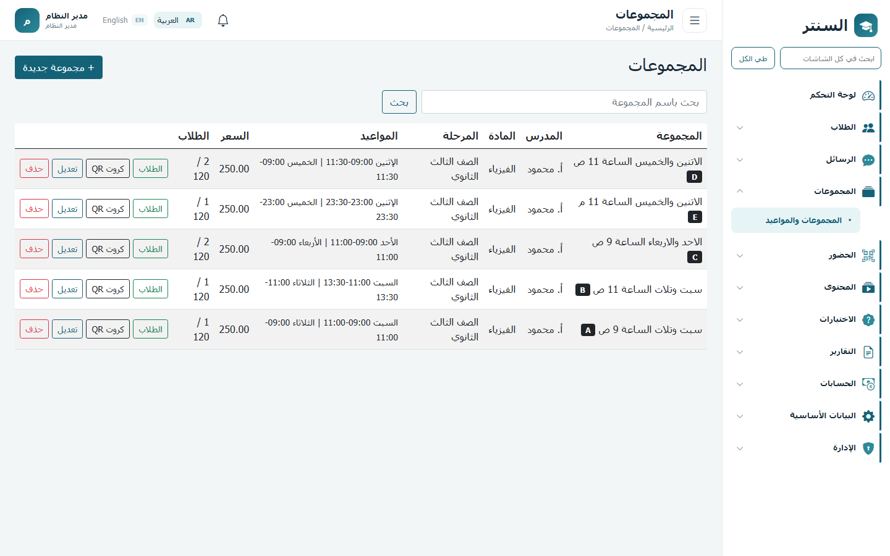
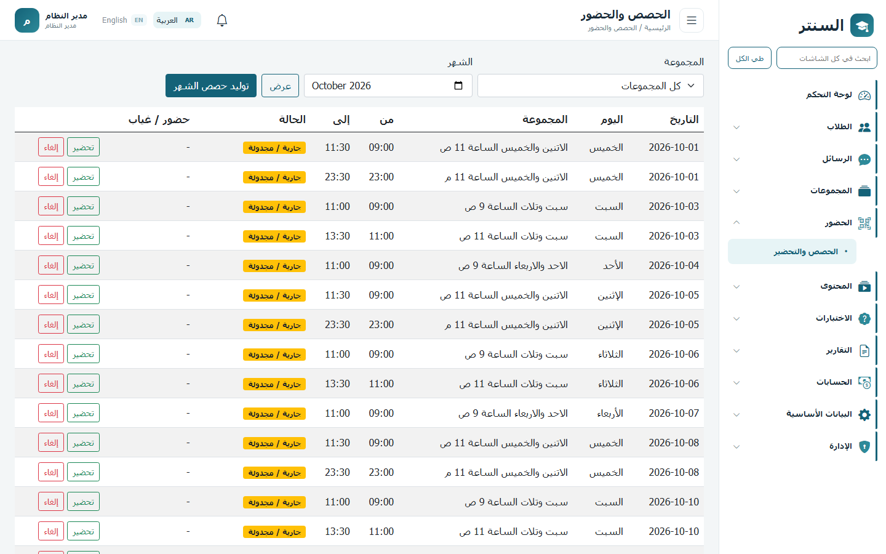
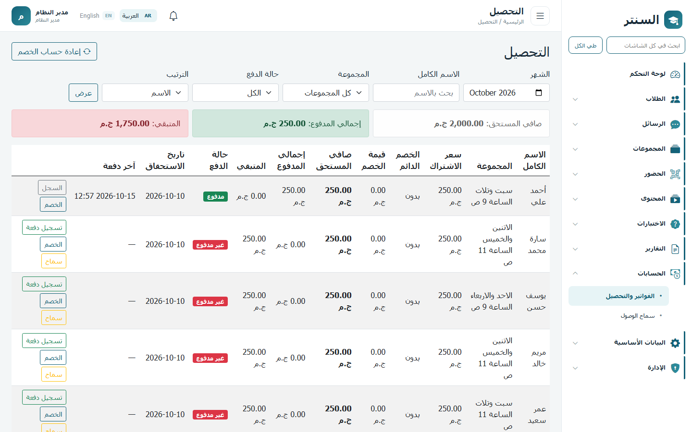
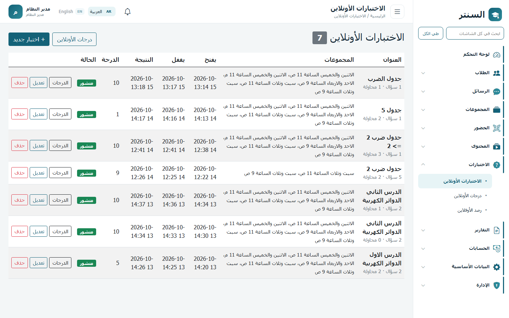

# السنتر

نظام إدارة سنتر تعليمي: الطلاب والمجموعات، الحضور، الماتريال والواجبات، الاختبارات، التحصيل الشهري، وبوابة للطالب. الواجهة عربية أولًا، ومعاها إنجليزي.

A tutoring-center system for students, groups, attendance, learning content, exams, monthly billing, and a student portal. Arabic-first, with English.

## لقطات

تسجيل الدخول.



لوحة التحكم: أعداد الطلاب والمجموعات، حضور آخر سبعة أيام، وملخص حسابات الشهر.



الطلاب: بحث، كود، كارنيه QR، وحساب دخول للبوابة.



المجموعات ومواعيدها الأسبوعية، مع المدرس والمادة وسعر الاشتراك.



حصص الشهر، وتوليدها من جدول المجموعة، ثم التحضير.



فواتير الشهر: المستحق، المدفوع، والمتبقي، مع تسجيل الدفع والخصم.



اختبارات أونلاين بنوافذ فتح وإغلاق، ونشر، ومتابعة الدرجات.



الأسماء والأرقام في الصور أعلاه بيانات عرض، مش بيانات حقيقية.

## ماذا يغطّي

**التشغيل اليومي**
- طلاب بكود ثابت وكارنيه QR، وبحث حسب الاسم أو الموبايل أو المرحلة.
- نقل طالب بين المجموعات مع الإبقاء على سجل الكود.
- مجموعات بمدرس ومادة ومرحلة وسعر شهري وجدول أسبوعي.
- توليد حصص الشهر من الجدول، وتحضير: حاضر، غائب، متأخر، بعذر.

**المحتوى والاختبار**
- ماتريال للمجموعة: فيديو، PDF، وصور، مع مسودة ونشر.
- واجبات PDF وWord.
- اختبار أونلاين باختيارات متعددة، ووقت فتح وإغلاق، وتسليم تلقائي، وإعادة فتح لمحاولة.
- درجات اختبار ورقي (أوفلاين) بجانب الأونلاين.
- تقارير طالب قابلة للطباعة.

**الحسابات**
- فاتورة شهرية لكل اشتراك، وخصم نسبة أو مبلغ، وتسجيل دفعات (كاش، محفظة، تحويل).
- سماح مؤقت للطالب يدخل الماتريال حتى لو الحساب لسه مفتوح.

**التواصل والصلاحيات**
- رسائل بين الطالب والمدرس، مع إشعارات فورية.
- ثلاثة أدوار: مدير، مدرس، طالب. كل شاشة لها صلاحية عرض وإضافة وتعديل وحذف.
- بوابة الطالب: ماتريال، واجبات، اختبارات، حضور، وسؤال للمدرس.
- جلسة واحدة نشطة للحساب، واللغة تتبدّل بين العربية والإنجليزية.

## من يستخدمه

| الدور | ما يراه |
| --- | --- |
| المدير | كل الشاشات: الطلاب، الحسابات، المستخدمين، والأدوار |
| المدرس | مجموعاته، والماتريال والواجبات والاختبارات والرسائل والتقارير |
| الطالب | البوابة فقط: محتواه، اختباراته، حضوره، ومحادثة مدرسه |

القائمة في لوحة الإدارة بتظهر الشاشات اللي للمستخدم صلاحية عرض عليها.

## التقنيات

- ASP.NET Core 8 MVC
- Entity Framework Core 8 و SQL Server
- ASP.NET Core Identity
- SignalR للرسائل والإشعارات
- Bootstrap وخط Cairo، واتجاه الواجهة RTL / LTR حسب اللغة

## هيكل المشروع

```
CenterApp.Web        الواجهة والمتحكمات وملفات الماتريال
CenterApp.Service    قواعد العمل، التقارير، والـ Migrations
CenterApp.Entity     الكيانات والصلاحيات
CenterApp.Tests      اختبارات
```

## التشغيل

المطلوب: .NET 8 SDK، و SQL Server LocalDB (أو أي SQL Server تعدّل سلسلة الاتصال عليه).

سلسلة الاتصال الافتراضية في `CenterApp.Web/appsettings.json`:

```
Server=(localdb)\MSSQLLocalDB;Database=CenterApp;Trusted_Connection=True;TrustServerCertificate=True
```

من جذر المشروع:

```bash
dotnet run --project CenterApp.Web
```

أول تشغيل يطبّق الـ Migrations وينشئ حساب المدير من إعداد `Seed` لو مش موجود.

حساب المدير الافتراضي موجود في `appsettings.json` تحت `Seed`. غيّره قبل أي استخدام خارج جهازك.

الماتريال والفيديو بيتحفظوا تحت `CenterApp.Web/App_Data`. تحويل مستندات الماتريال لصور صفحات يستخدم LibreOffice لو كان متسطبًا، والمسار في `Material:LibreOfficePath`.
